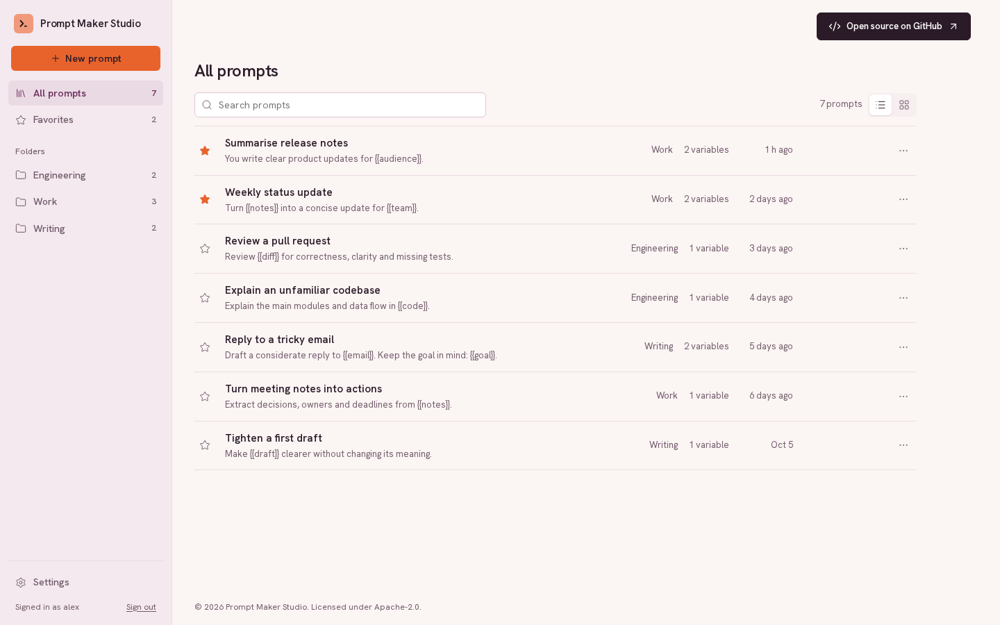
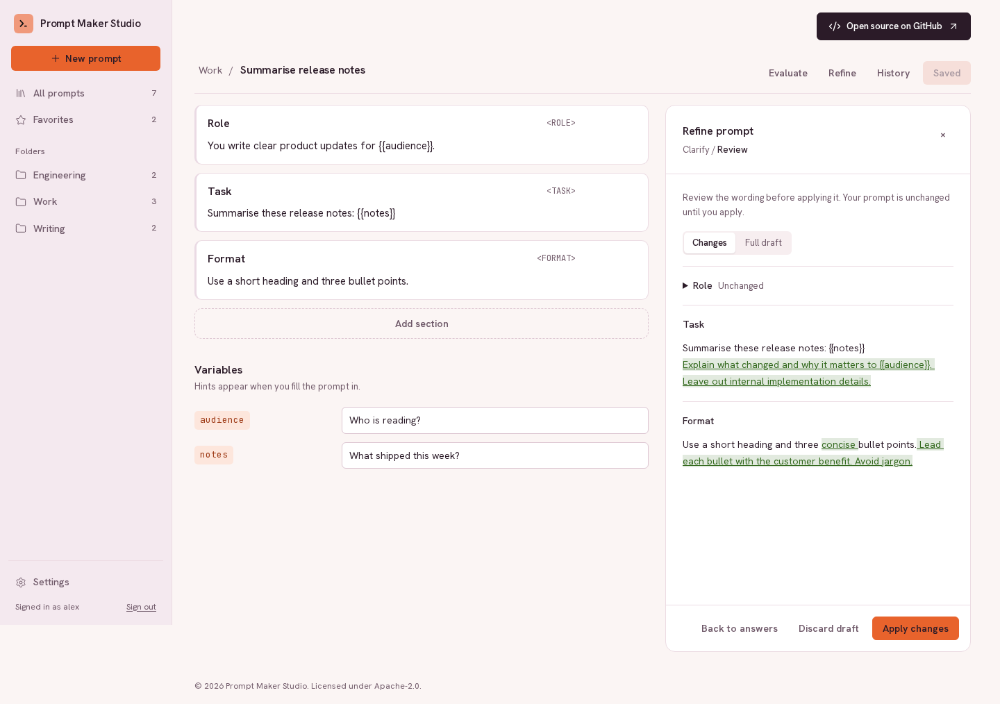
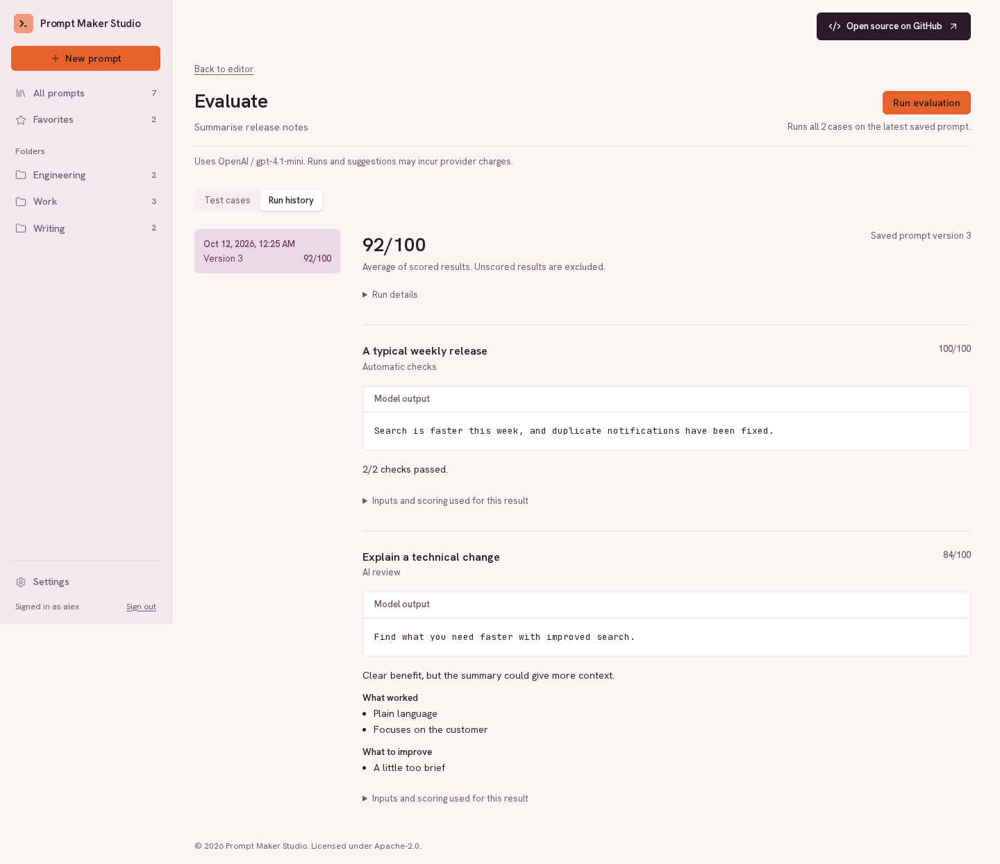
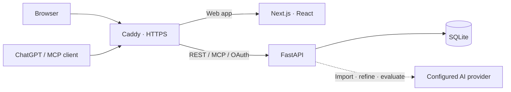

# Prompt Maker Studio

A self-hosted workspace for prompts you want to use again. Keep them organised,
refine the wording, and test how they perform before your next edit.

[](./LICENSE)
[](https://github.com/chrysogonus/prompt-maker-studio/actions/workflows/ci.yml)

[Get started](#quick-start-with-docker) · [Connect to ChatGPT](./docs/mcp.md) · [Contribute](./CONTRIBUTING.md)

## Keep your useful prompts close

Find prompts with search, folders and favourites. Write reusable sections with
`{{variables}}`, fill them in, and copy the result into any chat app. Saved
versions let you compare edits and restore an earlier approach.



## Turn a working prompt into a reusable template

Choose **Paste a prompt** in the library or editor. AI turns unstructured text
into XML-style sections and identifies variables with their original values
filled in. Review and edit the variables, keep an input fixed, and copy either
the template or filled prompt. Apply to the draft with Undo; Save keeps it.
Example inputs are separate from template content and require an explicit choice.

## Refine with a clear view of what changes

Answer clarifying questions, then review a proposed draft section by section.
See the wording changes before applying them; undo or save when you're ready.



## Test with examples that matter

Give a saved prompt test inputs and choose automatic checks, AI review or your
own rating. Inspect model outputs and feedback, then compare runs to understand
the effect of an edit. Keep your test cases reusable with CSV import and export.



*Screenshots use synthetic demo data, including illustrative AI outputs and scores.*

Prompt management works without an AI connection. Prompt conversion, refinement,
Try once and evaluation use your configured provider: OpenAI, Anthropic, Gemini, Ollama,
vLLM or another OpenAI-compatible endpoint. Hosted calls may incur provider
charges; operators can set monthly spending limits.

## Quick Start with Docker

You'll need Git, Docker with Compose, Make and OpenSSL.

```bash
git clone https://github.com/chrysogonus/prompt-maker-studio.git
cd prompt-maker-studio
make setup
make up
```

Open **[localhost:3000](http://localhost:3000)** and create your account.
The first account can register; further registration is closed by default.
For AI features, connect a provider under **Settings → AI connection**.

`make setup` creates local configuration with a generated signing key.
Browser API calls stay on the same origin through the frontend proxy.
Run `make down` to stop the app. See the [Docker guide](./docs/docker.md) for
configuration and local email testing.

## Architecture



Caddy handles production HTTPS and routing. Locally, Next.js proxies `/api`
to FastAPI. SQLite stores accounts, prompts, versions and evaluation history;
REST and MCP share the same prompt services. AI calls are optional.

## Go further

- [Development](./docs/development.md) — local setup, commands and tests.
- [Deployment](./docs/deployment.md) — hosting, HTTPS and backups.
- [Monitoring](./docs/monitoring.md) — dashboards, metrics, alerts and operator logs.
- [Configuration template](./.env.example) — available settings and defaults.
- [API reference](./docs/api.md) — REST routes; interactive schemas at [localhost:8000/docs](http://localhost:8000/docs).
- [MCP integration](./docs/mcp.md) — use your library from ChatGPT and other clients.
- [Contributing](./CONTRIBUTING.md) · [Code of Conduct](./CODE_OF_CONDUCT.md) · [Security](./SECURITY.md).

## Project status

Early-stage, `0.x`. APIs and database schemas may change between releases.
Back up before upgrading; see the [changelog](./CHANGELOG.md). The
[0.5.0 release record](./docs/releases/0.5.0.md) records publication, immutable
image digests and upgrade checks. Rehearse the migrations on an isolated
production-backup copy before upgrading a live instance.

## License

[Apache 2.0](./LICENSE). See [NOTICE](./NOTICE) and
[third-party notices](./THIRD_PARTY_NOTICES.md) for attribution.
