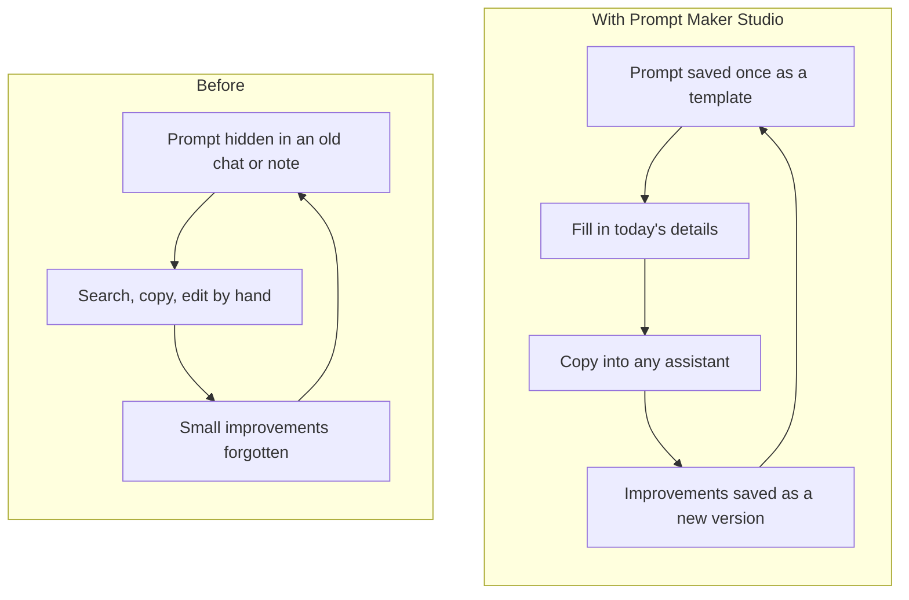
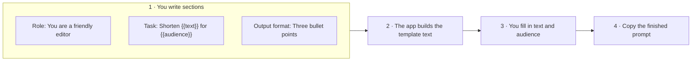
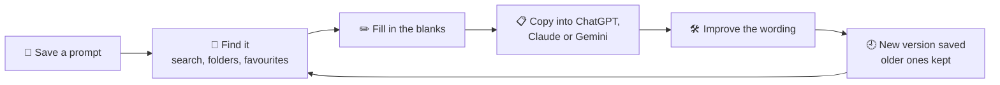
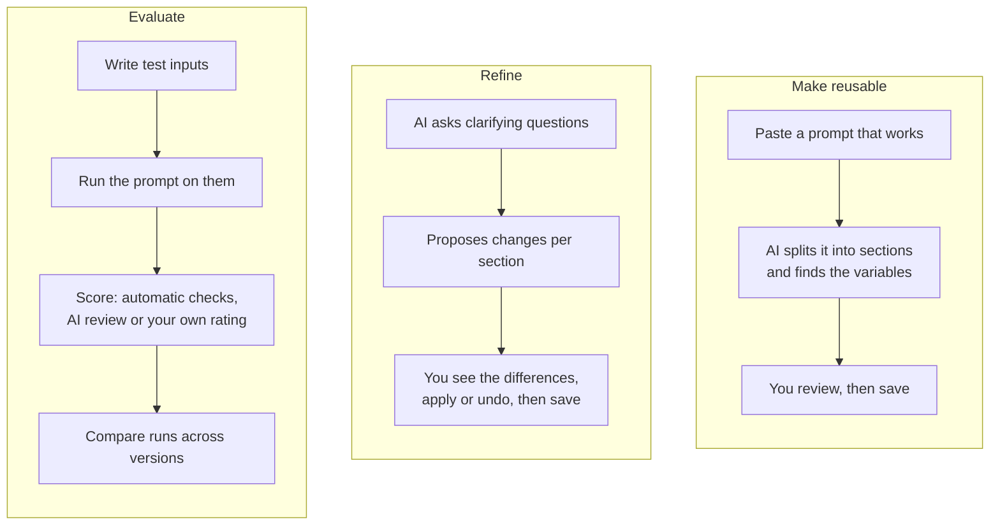
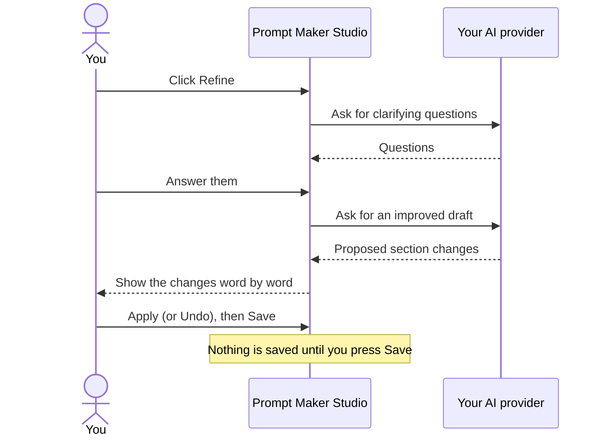
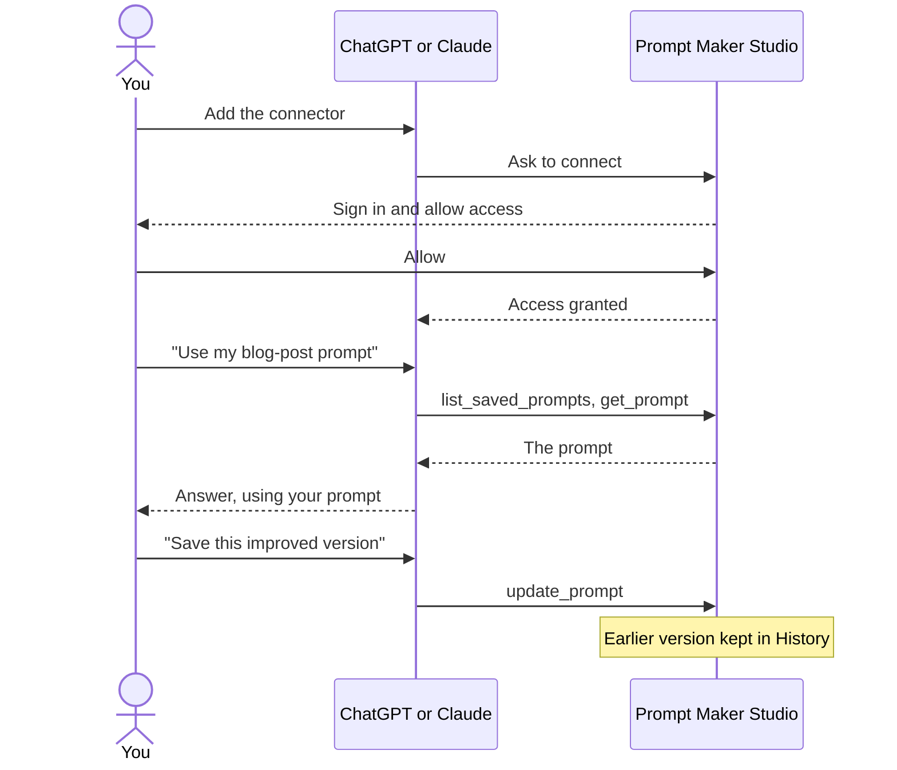
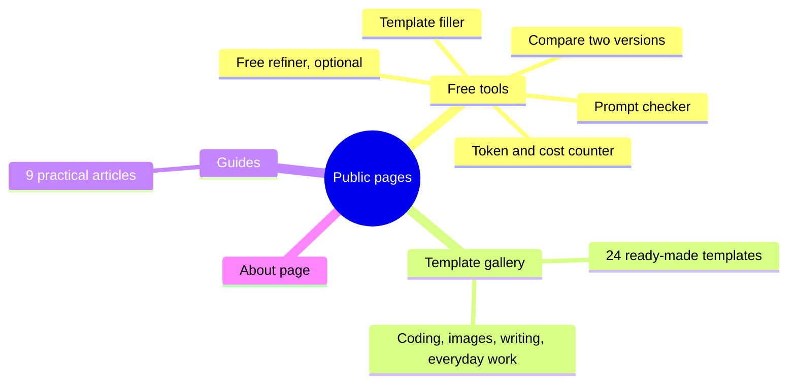
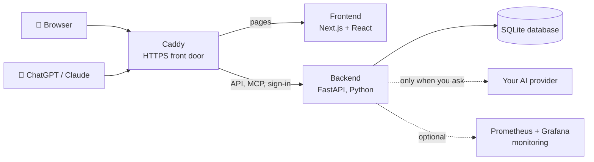
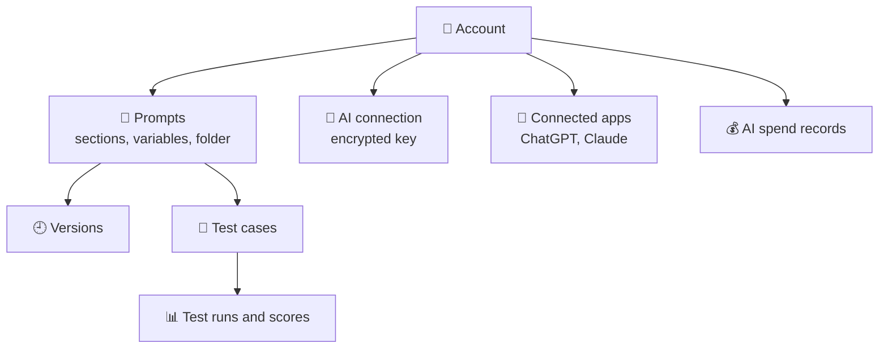
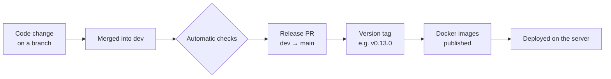

# How Prompt Maker Studio Works

A plain-language, visual overview of what this project does and how it is built.
Reviewed against the codebase on 2026-10-29.

This page simplifies on purpose. For exact behaviour, the [feature list](../product/FEATURES.md)
and the guides linked at the end are the source of truth.

## The 5-minute version

**In one sentence:** Prompt Maker Studio is a personal library for the AI prompts you use again
and again: save them once, fill in the parts that change, and copy them into any chat assistant.

- **Save** good prompts as templates with blanks to fill in, like `{{topic}}`.
- **Improve** them over time, with optional AI help and tests, and keep every version.
- **Use** them anywhere: copy from the web app, or open your library from inside ChatGPT or
  Claude.

### Talk outline

| # | Slide | Time | Key message | Show |
|---|---|---|---|---|
| 1 | The problem | 0:30 | Good prompts get lost and retyped | [The problem](#1-the-problem) |
| 2 | What a prompt looks like | 0:45 | Sections plus blanks to fill in | [Prompt anatomy](#2-what-a-prompt-looks-like-here) |
| 3 | The everyday loop | 0:45 | Find, fill, copy, improve | [Everyday loop](#3-the-everyday-loop) + screenshot |
| 4 | AI helpers | 1:00 | Optional help to convert, refine and test | [AI helpers](#4-ai-helpers-optional) + screenshots |
| 5 | ChatGPT and Claude | 0:45 | Your library inside the assistant | [MCP](#5-use-it-from-inside-chatgpt-or-claude) |
| 6 | Free public pages | 0:20 | Useful without an account | [Public pages](#6-free-pages-for-everyone) |
| 7 | Under the hood | 0:45 | Simple, self-hosted stack | [Architecture](#7-under-the-hood) |
| 8 | Built and shipped | 0:20 | Every change is checked automatically | [Pipeline](#8-how-it-is-built-and-shipped) |
| — | Wrap-up | 0:10 | Open source, private, self-hosted | [Key facts](#10-key-facts) |

Each section below is one slide: a picture, a short explanation and a 🎤 line you can say.

---

## 1. The problem

People who use ChatGPT, Claude or Gemini every day keep rewriting the same prompts. The good
versions sit in old chats and notes, small improvements are forgotten, and adapting a prompt
to today's details means editing text by hand.



> 🎤 *"We all have a few prompts that really work. This app makes sure you never lose them
> and never have to retype them."*

## 2. What a prompt looks like here

A prompt is a short list of **named sections** (such as Role, Task and Output format). Any
part that changes each time becomes a **variable**, written `{{like_this}}`. The app turns the
sections into the final text and fills in the variables for you.



The template text the app builds from those sections looks like this:

```text
<ROLE>
You are a friendly editor.
</ROLE>

<TASK>
Shorten {{text}} for {{audience}}.
</TASK>

<OUTPUT_FORMAT>
Three bullet points.
</OUTPUT_FORMAT>
```

One important rule: **the sections are the only source of the text.** The server always
builds the text from them, so what you see in the editor, what ChatGPT or Claude saves and
what you copy can never disagree.

> 🎤 *"A prompt is like a form letter: fixed parts you write once, and blanks you fill in each
> time."*

## 3. The everyday loop



- **Library:** search, folders and favourites, in a list or grid.
- **Editor:** a live preview shows exactly what will be copied.
- **History:** every saved change keeps the earlier version, so you can compare and restore.
- **Import:** bring in existing prompts from text, Markdown files, Obsidian or Notion.


> 🎤 *"Finding, filling in and copying a saved prompt takes seconds, even on a phone."*

## 4. AI helpers (optional)

Everything above works without any AI. Three optional helpers use AI to make prompts better:



How a refinement goes, step by step:




*Screenshots use synthetic demo data.*

Key points:

- **Bring your own AI.** Each user connects their own provider: OpenAI, Anthropic, Gemini,
  Ollama, vLLM or any OpenAI-compatible service. Keys are stored encrypted and never shown
  again. An operator can also offer a shared default connection.
- **Nothing runs on its own.** Every AI call needs a click, and you always review before saving.
- **Costs stay under control.** Every AI call is recorded, and operators can set monthly
  spending limits for everyone and per user.

> 🎤 *"AI is a helper, not a requirement. It suggests; you decide."*

## 5. Use it from inside ChatGPT or Claude

**MCP** (Model Context Protocol) is a standard plug that lets an AI assistant use an app's
tools. Prompt Maker Studio offers such a plug, so ChatGPT or Claude can read and save prompts
in your library while you chat.



- Five tools: list prompts, get a prompt, save a new one, update one, list its versions.
  Deleting is deliberately not offered.
- Sign-in uses **OAuth**, the same "Sign in and allow" pattern as "Log in with Google". You
  can disconnect any app in Settings.
- No AI provider key is needed here: the assistant's own plan does the thinking, and the app
  only stores and returns prompts.

> 🎤 *"Your library goes where you already work. The assistant can fetch a prompt, and save
> back the improved one."*

## 6. Free pages for everyone

Visitors who are not signed in still get useful pages. They are built to be found by search
engines and AI assistants, and invite people to keep their prompts in the app.



The tools run in the browser and upload nothing. The optional free refiner runs on the
operator's AI connection, with strict limits.

> 🎤 *"Anyone can try the tools and templates without an account."*

## 7. Under the hood



| Part | What it does, in one line |
|---|---|
| **Caddy** | The front door: handles HTTPS and sends each request to the right place. |
| **Frontend (Next.js, React, TypeScript)** | The screens you see: library, editor, settings, public pages. |
| **Backend (FastAPI, Python)** | The rules: accounts, saving prompts, versions, AI calls, the MCP plug. |
| **SQLite** | One database file that holds all the data. Backed up regularly. |
| **AI provider** | Only used for the optional AI helpers, with the user's own connection. |
| **Prometheus + Grafana** | Optional dashboards and alerts for the operator. |

Everything runs in **Docker** containers, started together with Docker Compose, so the whole
app can be self-hosted on one server.

What the database stores:



The web app and the ChatGPT/Claude plug use the **same backend code** for prompts, so the
rules are identical everywhere.

> 🎤 *"A deliberately simple stack: one front door, one web app, one API and one database
> file, all in Docker."*

## 8. How it is built and shipped



The automatic checks (CI) run on every change:

- scan for leaked secrets;
- backend style, security checks and tests (at least 90% of the code must be covered);
- frontend type checks, style, tests and a production build;
- Docker image build and vulnerability scan;
- real browser tests, including accessibility in light and dark mode;
- code security analysis.

A release only goes out when all of them pass. Publishing and deploying are separate, manual
steps.

> 🎤 *"Every change is tested automatically before it can be released."*

## 9. Safety and privacy at a glance

- **Private by design:** each account is its own library; there is no sharing between users.
- **Keys stay secret:** AI keys are encrypted and never shown again after saving.
- **Safe sign-in:** secure cookies with protection against forged requests, and rate limits
  on sensitive actions.
- **Spending limits:** operators can cap monthly AI costs.
- **Backups:** the database can be backed up and restored with integrity checks.
- **Open source:** Apache 2.0 licence; anyone can read the code and host it themselves.

## 10. Key facts

| Fact | Value |
|---|---|
| What it is | Self-hosted prompt library with optional AI help |
| Latest release | 0.13.0 (early stage, `0.x`) |
| Licence | Apache 2.0, open source |
| Backend | Python 3.12, FastAPI, SQLAlchemy, SQLite |
| Frontend | Next.js 16, React 18, TypeScript |
| Hosting | Docker Compose behind Caddy |
| AI providers | OpenAI, Anthropic, Gemini, Ollama, vLLM, OpenAI-compatible |
| ChatGPT / Claude tools | 5 MCP tools |
| Public content | 4 free tools (plus an optional free refiner), 24 templates, 9 guides |

> 🎤 *Closing line: "Save your best prompts once, improve them safely, and use them
> everywhere."*

## 11. Glossary

| Word | Meaning |
|---|---|
| **Prompt** | The instructions you give an AI assistant. |
| **Section** | A named part of a prompt, such as Role or Task. |
| **Variable** | A blank to fill in, written `{{name}}`. |
| **Template** | A prompt with its blanks still empty. |
| **Version** | A saved snapshot of a prompt; older ones can be restored. |
| **Refine** | Let AI suggest better wording, which you review. |
| **Evaluation** | Run a prompt on test inputs and score the answers. |
| **Provider** | The AI service that answers, such as OpenAI or Anthropic. |
| **MCP** | A standard plug that lets AI assistants use an app's tools. |
| **OAuth** | The "Sign in and allow access" step when connecting an app. |
| **Docker** | A way to package each part of the app so it runs the same anywhere. |
| **Caddy** | The web server in front of the app that provides HTTPS. |
| **CI** | Automatic checks that run on every code change. |

## Where to go next

- [README](../README.md): screenshots and the Docker quick start.
- [Implemented features](../product/FEATURES.md): everything the app does, in detail.
- [MCP](mcp.md): connecting ChatGPT, Claude and other clients.
- [Saved prompts](saved-prompts.md): sections, variables, versions, refinement and evaluation.
- [REST API](api.md) and [Deployment](deployment.md): for developers and operators.
